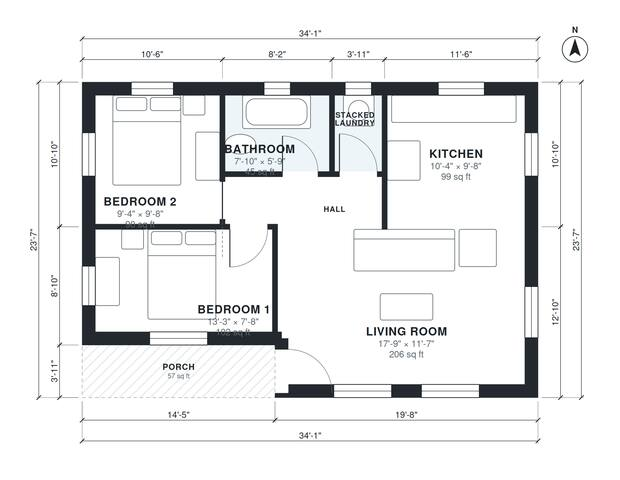

# 750 Sq Ft ADU Plans: 2-Bedroom Detached Backyard Cottage

This is a single-storey backyard cottage of about 750 sq ft, plus a small covered porch. The front door opens into a bright open living room and kitchen. A short hall leads to two bedrooms, a full bathroom and a stacked laundry closet. Windows on all sides bring in plenty of daylight. If you want a bigger bathroom or a wider Bedroom 1, we can adjust the room sizes.

| | |
|---|---|
| Levels | 1 |
| Footprint | 10.4 m × 7.2 m (34 ft × 24 ft) |
| Rooms | 7 indoor, 1 outdoor |
| Indoor area including garage, from the room grid | about 70 m² (749 sq ft) |

## Files here

- `area-schedule.csv` (room schedule)
- `building.json` (rooms, walls, openings as data)
- `plan-level1.dxf` (floor plan, DXF, drawing units: inches)

## More for this plan

- Plan page with the PDF plan set, IFC and 3D model, and a tool to change the plan: https://floorplan.ai-architectures.com/house-plans/750-sq-ft-adu-plans?utm_source=github-plans&utm_medium=probe&utm_campaign=github
- PDF plan set: https://storage.googleapis.com/20img/house-plans/750-sq-ft-adu-plans/plan-set.pdf
- IFC model: https://storage.googleapis.com/20img/house-plans/750-sq-ft-adu-plans/model.ifc

## Known issues in this drawing

- Bedroom 1 is only 2.34 m wide.

Concept design generated with AI. Not for construction or permit; verify with a licensed professional.
