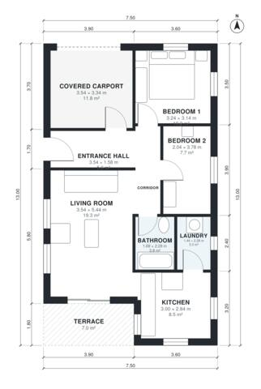

# 8 Meter Wide House Plans: 2-Bed Single-Story, 820 Sq Ft

This is a compact, single-storey 2-bedroom, 1-bath house on a narrow 7.5 m × 13 m footprint. It has about 75 m² of living space, not counting the carport and terrace. A covered carport and entrance hall sit at the front. The bedrooms and bathroom branch off a short corridor. An open kitchen and living area at the back leads to a terrace, with the laundry next to the kitchen.

| | |
|---|---|
| Levels | 1 |
| Footprint | 7.5 m × 13.0 m (25 ft × 43 ft) |
| Rooms | 9 indoor, 1 outdoor |
| Indoor area including garage, from the room grid | about 90 m² (974 sq ft) |

## Files here

- `area-schedule.csv` (room schedule)
- `building.json` (rooms, walls, openings as data)
- `plan-level1.dxf` (floor plan, DXF, drawing units: millimetres)

## More for this plan

- Plan page with the PDF plan set, IFC and 3D model, and a tool to change the plan: https://floorplan.ai-architectures.com/house-plans/8-meter-wide-house-plans?utm_source=github-plans&utm_medium=probe&utm_campaign=github
- PDF plan set: https://storage.googleapis.com/20img/house-plans/8-meter-wide-house-plans/plan-set.pdf
- IFC model: https://storage.googleapis.com/20img/house-plans/8-meter-wide-house-plans/model.ifc

## Known issues in this drawing

- Bedroom 2 is only 2.04 m wide.

Concept design generated with AI. Not for construction or permit; verify with a licensed professional.
