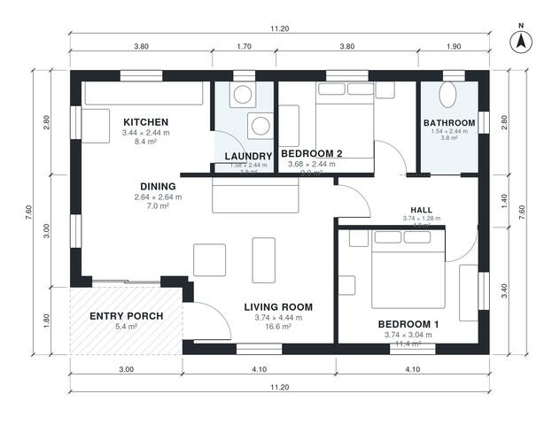

# 80 Square Meter House Plans: 860 Sq Ft, 2 Bed, 1 Bath

A compact single-storey 2-bedroom cottage of about 80 m² of living space, plus a covered entry porch. The front door opens through the porch into an open living, dining and kitchen area. Two bedrooms and a shared bathroom sit off a short hall, and the laundry is next to the kitchen. There is no garage.

| | |
|---|---|
| Levels | 1 |
| Footprint | 11.2 m × 7.6 m (37 ft × 25 ft) |
| Rooms | 8 indoor, 1 outdoor |
| Indoor area including garage, from the room grid | about 80 m² (858 sq ft) |

## Files here

- `area-schedule.csv` (room schedule)
- `building.json` (rooms, walls, openings as data)
- `plan-level1.dxf` (floor plan, DXF, drawing units: millimetres)

## More for this plan

- Plan page with the PDF plan set, IFC and 3D model, and a tool to change the plan: https://floorplan.ai-architectures.com/house-plans/80-square-meter-house-plans?utm_source=github-plans&utm_medium=probe&utm_campaign=github
- PDF plan set: https://storage.googleapis.com/20img/house-plans/80-square-meter-house-plans/plan-set.pdf
- IFC model: https://storage.googleapis.com/20img/house-plans/80-square-meter-house-plans/model.ifc

## Known issues in this drawing

- Bedroom 2 is only 2.44 m wide.

Concept design generated with AI. Not for construction or permit; verify with a licensed professional.
