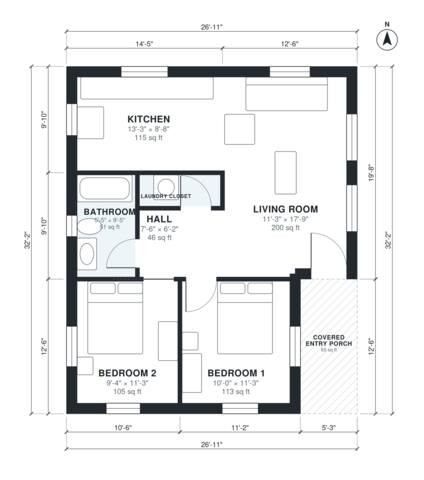

# 800 Sq Ft ADU Plans: 2 Bed, 1 Bath Detached Backyard Unit

This is a compact single-storey backyard ADU of about 800 sq ft indoors (roughly 27 ft x 32 ft including a covered entry porch at the front). The front door opens into an open living and kitchen area. A short hall leads to two bedrooms, a full bath and a laundry closet. All rooms have exterior windows, and the bedrooms are kept private from the living space.

| | |
|---|---|
| Levels | 1 |
| Footprint | 8.2 m × 9.8 m (27 ft × 32 ft) |
| Rooms | 7 indoor, 1 outdoor |
| Indoor area including garage, from the room grid | about 74 m² (800 sq ft) |

## Files here

- `area-schedule.csv` (room schedule)
- `building.json` (rooms, walls, openings as data)
- `plan-level1.dxf` (floor plan, DXF, drawing units: inches)

## More for this plan

- Plan page with the PDF plan set, IFC and 3D model, and a tool to change the plan: https://floorplan.ai-architectures.com/house-plans/800-sq-ft-adu-plans?utm_source=github-plans&utm_medium=probe&utm_campaign=github
- PDF plan set: https://storage.googleapis.com/20img/house-plans/800-sq-ft-adu-plans/plan-set.pdf
- IFC model: https://storage.googleapis.com/20img/house-plans/800-sq-ft-adu-plans/model.ifc

## Known issues in this drawing

- Living Room is 18.6 m² (asked for about 25.0 m²).

Concept design generated with AI. Not for construction or permit; verify with a licensed professional.
