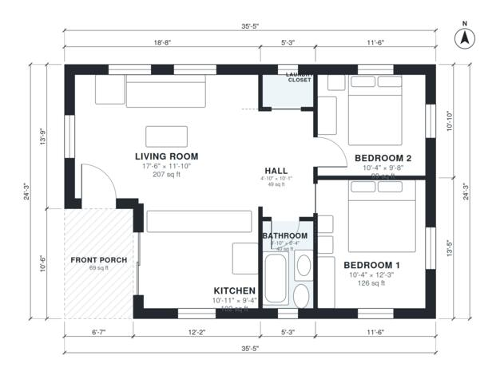

# 800 Sq Ft House Plans: 2-Bed, 1-Bath One-Story Layout

This is a compact one-story cottage of about 63 m² (roughly 680 sq ft) indoors, plus a covered front porch of about 6.4 m². The porch opens into an open living room and kitchen. A central hall leads to two bedrooms, a full bath and a laundry closet. The layout is efficient with good daylight and no wasted circulation.

| | |
|---|---|
| Levels | 1 |
| Footprint | 10.8 m × 7.4 m (35 ft × 24 ft) |
| Rooms | 7 indoor, 1 outdoor |
| Indoor area including garage, from the room grid | about 74 m² (791 sq ft) |

## Files here

- `building.json` (rooms, walls, openings as data)
- `plan-level1.dxf` (floor plan, DXF, drawing units: inches)

## More for this plan

- Plan page with the PDF plan set, IFC and 3D model, and a tool to change the plan: https://floorplan.ai-architectures.com/house-plans/800-sq-ft-house-plans?utm_source=github-plans&utm_medium=probe&utm_campaign=github
- PDF plan set: https://storage.googleapis.com/20img/house-plans/800-sq-ft-house-plans/plan-set.pdf
- IFC model: https://storage.googleapis.com/20img/house-plans/800-sq-ft-house-plans/model.ifc

## Known issues in this drawing

- None found by the automatic checks.

Concept design generated with AI. Not for construction or permit; verify with a licensed professional.
