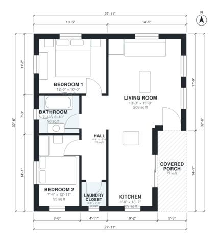

# 850 Sq Ft ADU Plans: 2 Bed, 1 Bath Detached Backyard ADU

This is a compact detached 2-bedroom, 1-bath backyard ADU of about 79 m² (850 sq ft) of living space, plus a covered front porch. You enter from the porch into an open kitchen and living area. A short central hall leads to the two bedrooms, the bathroom and the laundry closet. The bedrooms are kept apart from the living space for privacy.

| | |
|---|---|
| Levels | 1 |
| Footprint | 8.5 m × 9.9 m (28 ft × 32 ft) |
| Rooms | 7 indoor, 1 outdoor |
| Indoor area including garage, from the room grid | about 77 m² (828 sq ft) |

## Files here

- `area-schedule.csv` (room schedule)
- `building.json` (rooms, walls, openings as data)
- `plan-level1.dxf` (floor plan, DXF, drawing units: inches)

## More for this plan

- Plan page with the PDF plan set, IFC and 3D model, and a tool to change the plan: https://floorplan.ai-architectures.com/house-plans/850-sq-ft-adu-plans?utm_source=github-plans&utm_medium=probe&utm_campaign=github
- PDF plan set: https://storage.googleapis.com/20img/house-plans/850-sq-ft-adu-plans/plan-set.pdf
- IFC model: https://storage.googleapis.com/20img/house-plans/850-sq-ft-adu-plans/model.ifc

## Known issues in this drawing

- Bedroom 2 is only 2.24 m wide.

Concept design generated with AI. Not for construction or permit; verify with a licensed professional.
