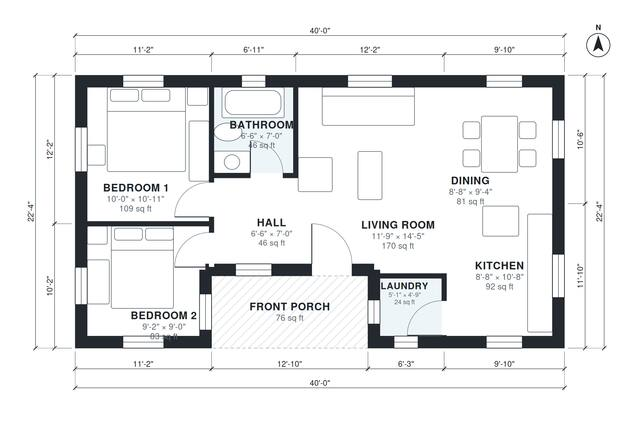

# 850 Sq Ft House Plans: 2 Bed, 1 Bath Single-Story Layout

This is a compact single-story 2-bedroom, 1-bath cottage of about 76 m² (820 sq ft) of interior space, plus a covered front porch. The open kitchen, dining and living area is bright and sits at the centre and east end of the house. Both bedrooms and the shared bath are grouped off a short hall at the west end, with a laundry closet beside the kitchen.

| | |
|---|---|
| Levels | 1 |
| Footprint | 12.2 m × 6.8 m (40 ft × 22 ft) |
| Rooms | 8 indoor, 1 outdoor |
| Indoor area including garage, from the room grid | about 76 m² (817 sq ft) |

## Files here

- `area-schedule.csv` (room schedule)
- `building.json` (rooms, walls, openings as data)
- `plan-level1.dxf` (floor plan, DXF, drawing units: inches)

## More for this plan

- Plan page with the PDF plan set, IFC and 3D model, and a tool to change the plan: https://floorplan.ai-architectures.com/house-plans/850-sq-ft-house-plans?utm_source=github-plans&utm_medium=probe&utm_campaign=github
- PDF plan set: https://storage.googleapis.com/20img/house-plans/850-sq-ft-house-plans/plan-set.pdf
- IFC model: https://storage.googleapis.com/20img/house-plans/850-sq-ft-house-plans/model.ifc

## Known issues in this drawing

- Laundry is 2.2 m² (asked for about 3.5 m²).

Concept design generated with AI. Not for construction or permit; verify with a licensed professional.
