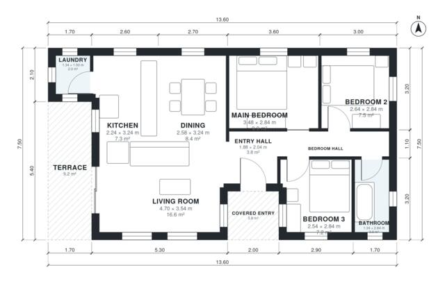

# 90 Square Meter House Plans: 3 Bed, 1 Bath, 960 Sq Ft

A compact single-storey home of about 90 m² indoors, with a 4 m² covered entry and an 8.5 m² terrace. The kitchen, dining and living room are open to each other, and the living room opens to the terrace. Three bedrooms and a shared bath sit off a short hall. The revision gives the hall more width so every bedroom opens from it, and it evens out the bedroom and dining sizes.

| | |
|---|---|
| Levels | 1 |
| Footprint | 13.6 m × 7.5 m (45 ft × 25 ft) |
| Rooms | 10 indoor, 2 outdoor |
| Indoor area including garage, from the room grid | about 89 m² (958 sq ft) |

## Files here

- `area-schedule.csv` (room schedule)
- `building.json` (rooms, walls, openings as data)
- `plan-level1.dxf` (floor plan, DXF, drawing units: millimetres)

## More for this plan

- Plan page with the PDF plan set, IFC and 3D model, and a tool to change the plan: https://floorplan.ai-architectures.com/house-plans/90-square-meter-house-plans?utm_source=github-plans&utm_medium=probe&utm_campaign=github
- PDF plan set: https://storage.googleapis.com/20img/house-plans/90-square-meter-house-plans/plan-set.pdf
- IFC model: https://storage.googleapis.com/20img/house-plans/90-square-meter-house-plans/model.ifc

## Known issues in this drawing

- Laundry is 2.0 m² (asked for about 3.5 m²).
- Dining is only 2.58 m wide.
- Bathroom is only 1.34 m wide.
- Main Bedroom is only 2.84 m wide.

Concept design generated with AI. Not for construction or permit; verify with a licensed professional.
