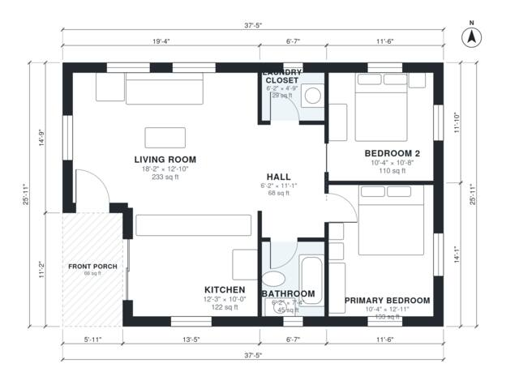

# 900 Sq Ft 2 Bedroom House Plans: Single-Story with Porch

This is a compact single-story cottage of about 83 m² (900 sq ft) of living space, plus a covered front porch. The front door opens into a spacious open kitchen and living area. A central hall leads to two bedrooms, a full bath and a laundry closet, and each room has window light.

| | |
|---|---|
| Levels | 1 |
| Footprint | 11.4 m × 7.9 m (37 ft × 26 ft) |
| Rooms | 7 indoor, 1 outdoor |
| Indoor area including garage, from the room grid | about 84 m² (904 sq ft) |

## Files here

- `area-schedule.csv` (room schedule)
- `building.json` (rooms, walls, openings as data)
- `plan-level1.dxf` (floor plan, DXF, drawing units: inches)

## More for this plan

- Plan page with the PDF plan set, IFC and 3D model, and a tool to change the plan: https://floorplan.ai-architectures.com/house-plans/900-sq-ft-2-bedroom-house-plans?utm_source=github-plans&utm_medium=probe&utm_campaign=github
- PDF plan set: https://storage.googleapis.com/20img/house-plans/900-sq-ft-2-bedroom-house-plans/plan-set.pdf
- IFC model: https://storage.googleapis.com/20img/house-plans/900-sq-ft-2-bedroom-house-plans/model.ifc

## Known issues in this drawing

- None found by the automatic checks.

Concept design generated with AI. Not for construction or permit; verify with a licensed professional.
