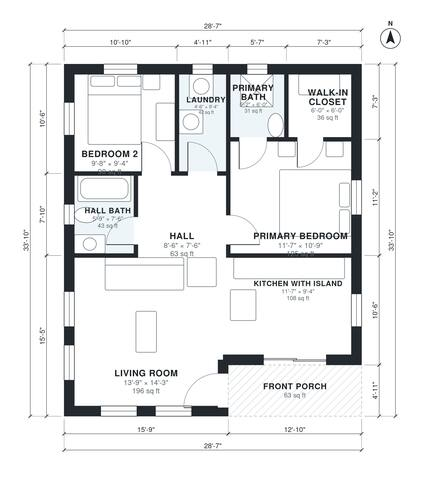

# 900 Sq Ft ADU Plans: 2 Bed, 2 Bath Detached Backyard Unit

This is a compact single-storey backyard cottage of about 84 m² (900 sq ft) indoors, plus a front porch. The porch opens into a bright open-plan living room and kitchen with an island. A central hall leads to two bedrooms, a hall bath and a laundry closet, and the primary bedroom has its own bath and walk-in closet.

| | |
|---|---|
| Levels | 1 |
| Footprint | 8.7 m × 10.3 m (29 ft × 34 ft) |
| Rooms | 9 indoor, 1 outdoor |
| Indoor area including garage, from the room grid | about 84 m² (902 sq ft) |

## Files here

- `area-schedule.csv` (room schedule)
- `building.json` (rooms, walls, openings as data)
- `plan-level1.dxf` (floor plan, DXF, drawing units: inches)

## More for this plan

- Plan page with the PDF plan set, IFC and 3D model, and a tool to change the plan: https://floorplan.ai-architectures.com/house-plans/900-sq-ft-adu-plans?utm_source=github-plans&utm_medium=probe&utm_campaign=github
- PDF plan set: https://storage.googleapis.com/20img/house-plans/900-sq-ft-adu-plans/plan-set.pdf
- IFC model: https://storage.googleapis.com/20img/house-plans/900-sq-ft-adu-plans/model.ifc

## Known issues in this drawing

- Primary Bath is 2.9 m² (asked for about 5.0 m²).

Concept design generated with AI. Not for construction or permit; verify with a licensed professional.
