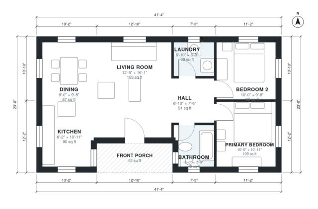

# 900 Sq Ft House Plans: 2 Bed, 1 Bath Single-Story Layout

This is a compact single-story 2-bedroom, 1-bath home of about 83 m² (roughly 890 sq ft) of living space, plus a covered front porch. The kitchen, dining and living areas form one open space with windows on three sides. The two bedrooms, the bath and the laundry sit off a short hall on the east side, away from the living space. The bathroom is a bit small, and the client can ask to enlarge it.

| | |
|---|---|
| Levels | 1 |
| Footprint | 12.6 m × 7.0 m (41 ft × 23 ft) |
| Rooms | 8 indoor, 1 outdoor |
| Indoor area including garage, from the room grid | about 82 m² (886 sq ft) |

## Files here

- `area-schedule.csv` (room schedule)
- `building.json` (rooms, walls, openings as data)
- `plan-level1.dxf` (floor plan, DXF, drawing units: inches)

## More for this plan

- Plan page with the PDF plan set, IFC and 3D model, and a tool to change the plan: https://floorplan.ai-architectures.com/house-plans/900-sq-ft-house-plans?utm_source=github-plans&utm_medium=probe&utm_campaign=github
- PDF plan set: https://storage.googleapis.com/20img/house-plans/900-sq-ft-house-plans/plan-set.pdf
- IFC model: https://storage.googleapis.com/20img/house-plans/900-sq-ft-house-plans/model.ifc

## Known issues in this drawing

- None found by the automatic checks.

Concept design generated with AI. Not for construction or permit; verify with a licensed professional.
