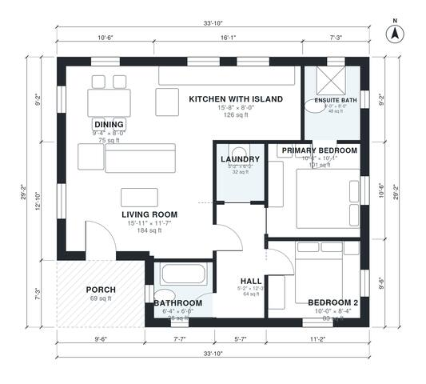

# 950 Sq Ft ADU Plans: 2 Bed 2 Bath Detached Backyard Home

This is a single-storey backyard ADU of about 91 m² (roughly 980 sq ft) including a covered front porch, with about 88 m² (950 sq ft) of interior space. An open kitchen with island, dining and living area fills the front and left of the plan, and a short hall leads to the two bedrooms, the hall bath and the laundry. The primary bedroom has its own ensuite.

| | |
|---|---|
| Levels | 1 |
| Footprint | 10.3 m × 8.9 m (34 ft × 29 ft) |
| Rooms | 9 indoor, 1 outdoor |
| Indoor area including garage, from the room grid | about 85 m² (918 sq ft) |

## Files here

- `area-schedule.csv` (room schedule)
- `building.json` (rooms, walls, openings as data)
- `plan-level1.dxf` (floor plan, DXF, drawing units: inches)

## More for this plan

- Plan page with the PDF plan set, IFC and 3D model, and a tool to change the plan: https://floorplan.ai-architectures.com/house-plans/950-sq-ft-adu-plans?utm_source=github-plans&utm_medium=probe&utm_campaign=github
- PDF plan set: https://storage.googleapis.com/20img/house-plans/950-sq-ft-adu-plans/plan-set.pdf
- IFC model: https://storage.googleapis.com/20img/house-plans/950-sq-ft-adu-plans/model.ifc

## Known issues in this drawing

- Bedroom 2 is 7.7 m² (asked for about 11.0 m²).
- Primary Bedroom is 9.4 m² (asked for about 13.0 m²).
- Dining is only 2.44 m wide.

Concept design generated with AI. Not for construction or permit; verify with a licensed professional.
