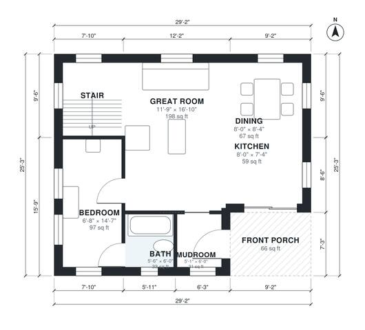

# A Frame House Plans: 2-Bed, 2-Bath Loft Cabin, 1,160 Sq Ft

This is a two-level A-frame cabin of about 8.9 x 7.7 m, with roughly 100 m² (about 1,100 sq ft) of living space plus a covered front porch. The ground floor has an open great room, kitchen and dining area, a bedroom with a bath, and a mudroom entry. A stair leads up to a loft bedroom suite with its own bath, and the loft looks out over a double-height void above the great room.

| | |
|---|---|
| Levels | 2 |
| Footprint | 8.9 m × 7.7 m (29 ft × 25 ft) |
| Rooms | 11 indoor, 2 outdoor |
| Indoor area including garage, from the room grid | about 108 m² (1,157 sq ft) |

## Files here

- `area-schedule.csv` (room schedule)
- `building.json` (rooms, walls, openings as data)
- `plan-level1.dxf` (floor plan, DXF, drawing units: inches)
- `plan-level2.dxf` (floor plan, DXF, drawing units: inches)

## More for this plan

- Plan page with the PDF plan set, IFC and 3D model, and a tool to change the plan: https://floorplan.ai-architectures.com/house-plans/a-frame-house-plans?utm_source=github-plans&utm_medium=probe&utm_campaign=github
- PDF plan set: https://storage.googleapis.com/20img/house-plans/a-frame-house-plans/plan-set.pdf
- IFC model: https://storage.googleapis.com/20img/house-plans/a-frame-house-plans/model.ifc

## Known issues in this drawing

- Bedroom is only 2.04 m wide.
- Bath is 3.1 m² (asked for about 4.5 m²).
- Kitchen is 5.5 m² (asked for about 9.0 m²).
- Dining is only 2.44 m wide.

Concept design generated with AI. Not for construction or permit; verify with a licensed professional.
