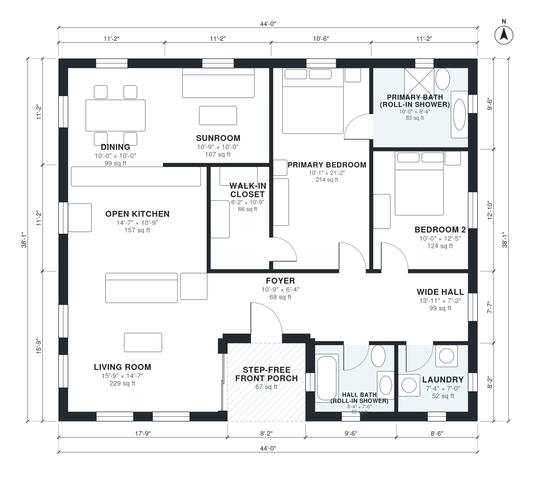

# Accessible House Plans: 2-Bed, 2-Bath Single-Level Home

This single-level, step-free ranch is about 1,600 sq ft. It has an open kitchen, living and dining core with a sunroom, and two bedrooms off a wide hall. Both baths have roll-in showers. The revision widens the bedrooms, closet and kitchen so a wheelchair can turn comfortably, and gives the sunroom its own identity.

| | |
|---|---|
| Levels | 1 |
| Footprint | 13.4 m × 11.6 m (44 ft × 38 ft) |
| Rooms | 12 indoor, 1 outdoor |
| Indoor area including garage, from the room grid | about 149 m² (1,606 sq ft) |

## Files here

- `area-schedule.csv` (room schedule)
- `building.json` (rooms, walls, openings as data)
- `plan-level1.dxf` (floor plan, DXF, drawing units: inches)

## More for this plan

- Plan page with the PDF plan set, IFC and 3D model, and a tool to change the plan: https://floorplan.ai-architectures.com/house-plans/accessible-house-plans?utm_source=github-plans&utm_medium=probe&utm_campaign=github
- PDF plan set: https://storage.googleapis.com/20img/house-plans/accessible-house-plans/plan-set.pdf
- IFC model: https://storage.googleapis.com/20img/house-plans/accessible-house-plans/model.ifc

## Known issues in this drawing

- Open Kitchen is only 3.28 m wide.
- Primary Bedroom is only 3.08 m wide.
- Bedroom 2 is only 3.04 m wide.

Concept design generated with AI. Not for construction or permit; verify with a licensed professional.
