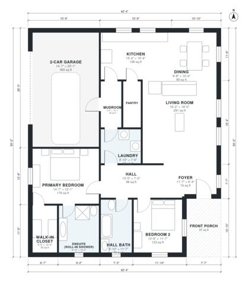

# Accessible Ranch House Plans: 2-Bed, 2-Bath, 1,610 Sq Ft

This is a single-storey, step-free ranch with about 148 m² (1,600 sq ft) of living space. The garage and porch add roughly 49 m² on top of that. It has an open kitchen, dining and living area at the front and east side, and a bedroom wing off a wide hall. The primary suite has a roll-in shower ensuite and a walk-in closet. There is also a second bedroom, an accessible hall bath, a laundry and mudroom, and a 2-car garage beside the covered front porch.

| | |
|---|---|
| Levels | 1 |
| Footprint | 12.9 m × 15.3 m (42 ft × 50 ft) |
| Rooms | 14 indoor, 1 outdoor |
| Indoor area including garage, from the room grid | about 188 m² (2,028 sq ft) |

## Files here

- `area-schedule.csv` (room schedule)
- `building.json` (rooms, walls, openings as data)
- `plan-level1.dxf` (floor plan, DXF, drawing units: inches)

## More for this plan

- Plan page with the PDF plan set, IFC and 3D model, and a tool to change the plan: https://floorplan.ai-architectures.com/house-plans/accessible-ranch-house-plans?utm_source=github-plans&utm_medium=probe&utm_campaign=github
- PDF plan set: https://storage.googleapis.com/20img/house-plans/accessible-ranch-house-plans/plan-set.pdf
- IFC model: https://storage.googleapis.com/20img/house-plans/accessible-ranch-house-plans/model.ifc

## Known issues in this drawing

- Hall Bath is only 2.08 m wide.

Concept design generated with AI. Not for construction or permit; verify with a licensed professional.
