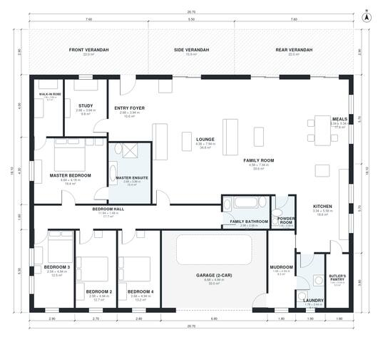

# Acreage House Plans: 3,000 Sq Ft, 4-Bed Single-Story Home

A wide single-storey homestead of about 280 m² of living space, plus a 2-car garage and verandahs on the front, side and rear. A central open kitchen, meals, family and lounge zone sits between the study and entry and a quiet bedroom wing. The master suite has an ensuite and walk-in robe. The garage enters through the mudroom beside the kitchen and laundry.

| | |
|---|---|
| Levels | 1 |
| Footprint | 20.7 m × 18.1 m (68 ft × 59 ft) |
| Rooms | 19 indoor, 3 outdoor |
| Indoor area including garage, from the room grid | about 315 m² (3,387 sq ft) |

## Files here

- `area-schedule.csv` (room schedule)
- `building.json` (rooms, walls, openings as data)
- `plan-level1.dxf` (floor plan, DXF, drawing units: millimetres)

## More for this plan

- Plan page with the PDF plan set, IFC and 3D model, and a tool to change the plan: https://floorplan.ai-architectures.com/house-plans/acreage-house-plans?utm_source=github-plans&utm_medium=probe&utm_campaign=github
- PDF plan set: https://storage.googleapis.com/20img/house-plans/acreage-house-plans/plan-set.pdf
- IFC model: https://storage.googleapis.com/20img/house-plans/acreage-house-plans/model.ifc

## Known issues in this drawing

- Front Verandah is not on the street side.
- Side Verandah is not on the street side.

Concept design generated with AI. Not for construction or permit; verify with a licensed professional.
