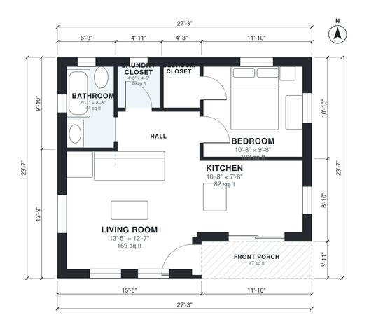

# ADU Floor Plans: 1-Bedroom Detached Backyard Cottage Plan

This is a compact detached backyard cottage of about 600 sq ft (roughly 27'-3" x 23'-7") with a 47 sq ft covered front porch. The front door opens into an open living room and kitchen. A short hall leads to a private bedroom with a closet, a full bath and a laundry closet. It has good daylight and a simple, efficient layout.

| | |
|---|---|
| Levels | 1 |
| Footprint | 8.3 m × 7.2 m (27 ft × 24 ft) |
| Rooms | 7 indoor, 1 outdoor |
| Indoor area including garage, from the room grid | about 55 m² (597 sq ft) |

## Files here

- `area-schedule.csv` (room schedule)
- `building.json` (rooms, walls, openings as data)
- `plan-level1.dxf` (floor plan, DXF, drawing units: inches)

## More for this plan

- Plan page with the PDF plan set, IFC and 3D model, and a tool to change the plan: https://floorplan.ai-architectures.com/house-plans/adu-floor-plans?utm_source=github-plans&utm_medium=probe&utm_campaign=github
- PDF plan set: https://storage.googleapis.com/20img/house-plans/adu-floor-plans/plan-set.pdf
- IFC model: https://storage.googleapis.com/20img/house-plans/adu-floor-plans/model.ifc

## Known issues in this drawing

- None found by the automatic checks.

Concept design generated with AI. Not for construction or permit; verify with a licensed professional.
