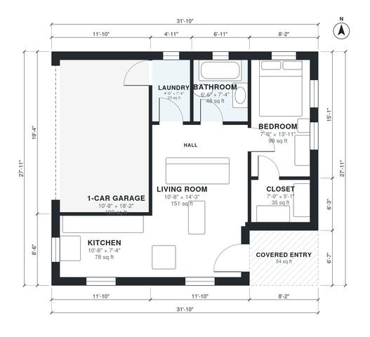

# ADU With Garage Plans: 610 Sq Ft 1-Bed, 1-Bath Detached ADU

This is a compact one-bedroom, one-bath ADU of roughly 600 sq ft of living space, with a 1-car garage attached on the side and not counted in that area. A covered entry opens into an open kitchen and living room. A short hall serves the private bedroom with its walk-in closet, the bathroom and the laundry. The laundry also acts as a buffer toward the garage.

| | |
|---|---|
| Levels | 1 |
| Footprint | 9.7 m × 8.5 m (32 ft × 28 ft) |
| Rooms | 8 indoor, 1 outdoor |
| Indoor area including garage, from the room grid | about 77 m² (834 sq ft) |

## Files here

- `area-schedule.csv` (room schedule)
- `building.json` (rooms, walls, openings as data)
- `plan-level1.dxf` (floor plan, DXF, drawing units: inches)

## More for this plan

- Plan page with the PDF plan set, IFC and 3D model, and a tool to change the plan: https://floorplan.ai-architectures.com/house-plans/adu-with-garage-plans?utm_source=github-plans&utm_medium=probe&utm_campaign=github
- PDF plan set: https://storage.googleapis.com/20img/house-plans/adu-with-garage-plans/plan-set.pdf
- IFC model: https://storage.googleapis.com/20img/house-plans/adu-with-garage-plans/model.ifc

## Known issues in this drawing

- Bedroom is only 2.14 m wide.

Concept design generated with AI. Not for construction or permit; verify with a licensed professional.
