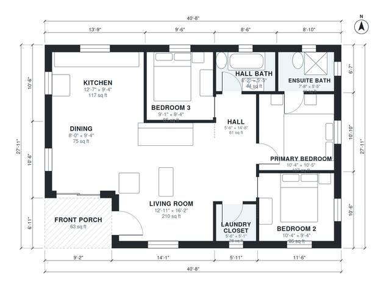

# Affordable House Plans: 3 Bed, 2 Bath, 1,070 Sq Ft One-Story

This is a compact single-storey 3-bedroom, 2-bath ranch of about 105 m² (about 1,130 sq ft) on a simple rectangle with a gable roof. A front porch opens into an open kitchen, dining and living area. The three bedrooms and two baths sit together in the east wing off a short hall, with the primary bedroom's ensuite at the north-east corner. A laundry closet is beside the hall, and there is no garage.

| | |
|---|---|
| Levels | 1 |
| Footprint | 12.4 m × 8.5 m (41 ft × 28 ft) |
| Rooms | 10 indoor, 1 outdoor |
| Indoor area including garage, from the room grid | about 100 m² (1,071 sq ft) |

## Files here

- `area-schedule.csv` (room schedule)
- `building.json` (rooms, walls, openings as data)
- `plan-level1.dxf` (floor plan, DXF, drawing units: inches)

## More for this plan

- Plan page with the PDF plan set, IFC and 3D model, and a tool to change the plan: https://floorplan.ai-architectures.com/house-plans/affordable-house-plans?utm_source=github-plans&utm_medium=probe&utm_campaign=github
- PDF plan set: https://storage.googleapis.com/20img/house-plans/affordable-house-plans/plan-set.pdf
- IFC model: https://storage.googleapis.com/20img/house-plans/affordable-house-plans/model.ifc

## Known issues in this drawing

- Dining is only 2.44 m wide.

Concept design generated with AI. Not for construction or permit; verify with a licensed professional.
