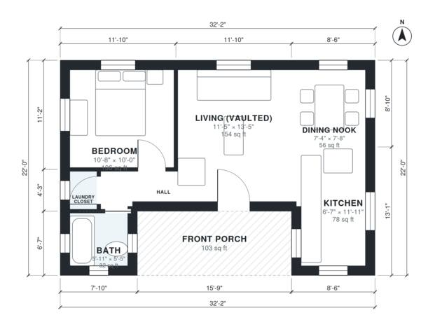

# Backyard Cottage Plans: 600 Sq Ft, 1 Bed, 1 Bath Layout

This is a one-level backyard cottage of about 600 sq ft of heated space. A deep covered front porch adds roughly 108 sq ft, so the full footprint is about 32' x 22'. The porch leads into an open, vaulted living area that flows into the kitchen and a small dining nook. A short hall serves the quiet bedroom, a full bath and a laundry closet. The kitchen and dining areas are compact, so we can trade some living space or porch depth for more room there if you'd like.

| | |
|---|---|
| Levels | 1 |
| Footprint | 9.8 m × 6.7 m (32 ft × 22 ft) |
| Rooms | 7 indoor, 1 outdoor |
| Indoor area including garage, from the room grid | about 56 m² (603 sq ft) |

## Files here

- `area-schedule.csv` (room schedule)
- `building.json` (rooms, walls, openings as data)
- `plan-level1.dxf` (floor plan, DXF, drawing units: inches)

## More for this plan

- Plan page with the PDF plan set, IFC and 3D model, and a tool to change the plan: https://floorplan.ai-architectures.com/house-plans/backyard-cottage-plans?utm_source=github-plans&utm_medium=probe&utm_campaign=github
- PDF plan set: https://storage.googleapis.com/20img/house-plans/backyard-cottage-plans/plan-set.pdf
- IFC model: https://storage.googleapis.com/20img/house-plans/backyard-cottage-plans/model.ifc

## Known issues in this drawing

- Bath is 3.0 m² (asked for about 5.0 m²).
- Kitchen is 7.3 m² (asked for about 10.0 m²).
- Kitchen is only 2.00 m wide.

Concept design generated with AI. Not for construction or permit; verify with a licensed professional.
