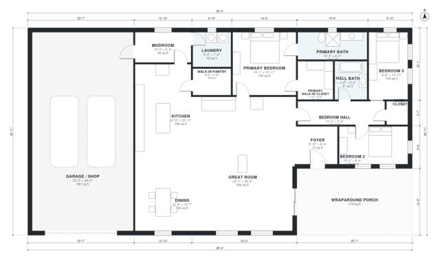

# Barndominium Floor Plans: 3-Bed, 2-Bath, 2,460 Sq Ft Plan

A one-story barndominium of about 2,400 sq ft heated, with a very large open great room, kitchen and dining area under a gable roof. The garage shop is oversized and connects through a mudroom and laundry. The revision moves the primary suite onto the bedroom hall for privacy, widens the footprint so the garage and kitchen are less cramped, and adds a rear patio to go with the front porch.

| | |
|---|---|
| Levels | 1 |
| Footprint | 26.0 m × 14.0 m (85 ft × 46 ft) |
| Rooms | 16 indoor, 1 outdoor |
| Indoor area including garage, from the room grid | about 329 m² (3,540 sq ft) |

## Files here

- `building.json` (rooms, walls, openings as data)
- `plan-level1.dxf` (floor plan, DXF, drawing units: inches)

## More for this plan

- Plan page with the PDF plan set, IFC and 3D model, and a tool to change the plan: https://floorplan.ai-architectures.com/house-plans/barndominium-floor-plans?utm_source=github-plans&utm_medium=probe&utm_campaign=github
- PDF plan set: https://storage.googleapis.com/20img/house-plans/barndominium-floor-plans/plan-set.pdf
- IFC model: https://storage.googleapis.com/20img/house-plans/barndominium-floor-plans/model.ifc

## Known issues in this drawing

- Garage / Shop is only 6.84 m wide.
- Kitchen is only 3.78 m wide.
- Kitchen has no window.

Concept design generated with AI. Not for construction or permit; verify with a licensed professional.
