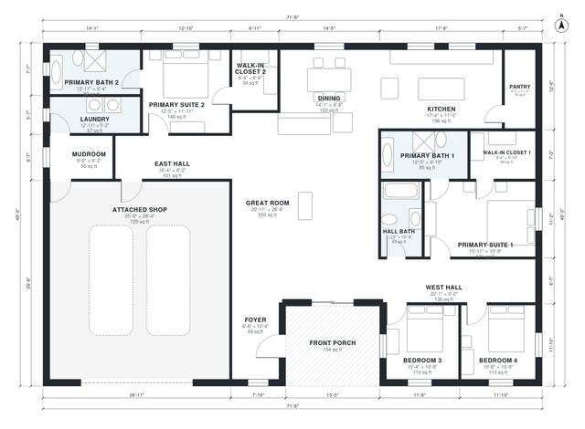

# Barndominium With 2 Master Suites: 2,570 Sq Ft, 4 Bed Plan

This single-story barndominium has about 240-250 m² (roughly 2,600 sq ft) of living space. The two primary suites, each with a walk-in closet and bath, sit at opposite ends of the house. An open great room, kitchen and dining area fills the middle, and two secondary bedrooms share a hall bath. A mudroom connects the kitchen, laundry and the roughly 70 m² attached shop, and a covered front porch marks the entry. The hall bath, pantry and one closet came out a bit smaller than planned, and you can adjust them in the next revision.

| | |
|---|---|
| Levels | 1 |
| Footprint | 21.8 m × 15.0 m (72 ft × 49 ft) |
| Rooms | 19 indoor, 1 outdoor |
| Indoor area including garage, from the room grid | about 313 m² (3,365 sq ft) |

## Files here

- `area-schedule.csv` (room schedule)
- `building.json` (rooms, walls, openings as data)
- `plan-level1.dxf` (floor plan, DXF, drawing units: inches)

## More for this plan

- Plan page with the PDF plan set, IFC and 3D model, and a tool to change the plan: https://floorplan.ai-architectures.com/house-plans/barndominium-with-2-master-suites?utm_source=github-plans&utm_medium=probe&utm_campaign=github
- PDF plan set: https://storage.googleapis.com/20img/house-plans/barndominium-with-2-master-suites/plan-set.pdf
- IFC model: https://storage.googleapis.com/20img/house-plans/barndominium-with-2-master-suites/model.ifc

## Known issues in this drawing

- Kitchen and Mudroom are not directly connected.

Concept design generated with AI. Not for construction or permit; verify with a licensed professional.
