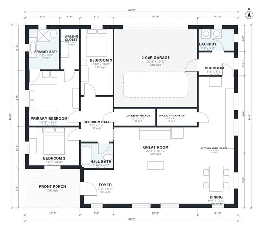

# Barndominium With Garage Floor Plans: 3 Bed, 1,800 Sq Ft

This is a single-story rectangular barndominium with about 167 m² (1,800 sq ft) of living space, plus a 2-car garage and a front porch. The open great room, island kitchen and dining area sit at the centre of the plan. The garage opens through a mudroom and laundry next to a walk-in pantry. The three bedrooms are grouped at the west end, including a primary suite with its own bath and walk-in closet.

| | |
|---|---|
| Levels | 1 |
| Footprint | 15.9 m × 13.7 m (52 ft × 45 ft) |
| Rooms | 16 indoor, 1 outdoor |
| Indoor area including garage, from the room grid | about 206 m² (2,217 sq ft) |

## Files here

- `area-schedule.csv` (room schedule)
- `building.json` (rooms, walls, openings as data)
- `plan-level1.dxf` (floor plan, DXF, drawing units: inches)

## More for this plan

- Plan page with the PDF plan set, IFC and 3D model, and a tool to change the plan: https://floorplan.ai-architectures.com/house-plans/barndominium-with-garage-floor-plans?utm_source=github-plans&utm_medium=probe&utm_campaign=github
- PDF plan set: https://storage.googleapis.com/20img/house-plans/barndominium-with-garage-floor-plans/plan-set.pdf
- IFC model: https://storage.googleapis.com/20img/house-plans/barndominium-with-garage-floor-plans/model.ifc

## Known issues in this drawing

- Bedroom 3 is only 2.38 m wide.

Concept design generated with AI. Not for construction or permit; verify with a licensed professional.
