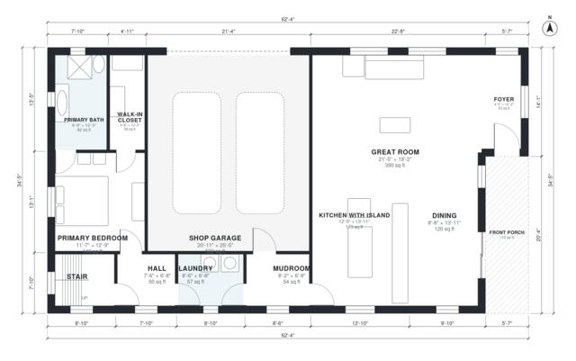

# Barndominium With Loft Floor Plans: 3 Bed, 2,350 Sq Ft

A two-level barndominium of roughly 2,370 sq ft of living space, plus a 55 m² shop garage and a front porch. The ground floor has an open great room, island kitchen and dining, a primary suite with bath and walk-in closet, laundry, mudroom and shop garage. Upstairs, an open loft serves two bedrooms and a bath.

| | |
|---|---|
| Levels | 2 |
| Footprint | 19.0 m × 10.5 m (62 ft × 34 ft) |
| Rooms | 17 indoor, 2 outdoor |
| Indoor area including garage, from the room grid | about 271 m² (2,916 sq ft) |

## Files here

- `area-schedule.csv` (room schedule)
- `building.json` (rooms, walls, openings as data)
- `plan-level1.dxf` (floor plan, DXF, drawing units: inches)
- `plan-level2.dxf` (floor plan, DXF, drawing units: inches)

## More for this plan

- Plan page with the PDF plan set, IFC and 3D model, and a tool to change the plan: https://floorplan.ai-architectures.com/house-plans/barndominium-with-loft-floor-plans?utm_source=github-plans&utm_medium=probe&utm_campaign=github
- PDF plan set: https://storage.googleapis.com/20img/house-plans/barndominium-with-loft-floor-plans/plan-set.pdf
- IFC model: https://storage.googleapis.com/20img/house-plans/barndominium-with-loft-floor-plans/model.ifc

## Known issues in this drawing

- Foyer and Hall are not directly connected.
- Foyer is 5.0 m² (asked for about 7.0 m²).
- Bedroom 3 is only 2.34 m wide.

Concept design generated with AI. Not for construction or permit; verify with a licensed professional.
