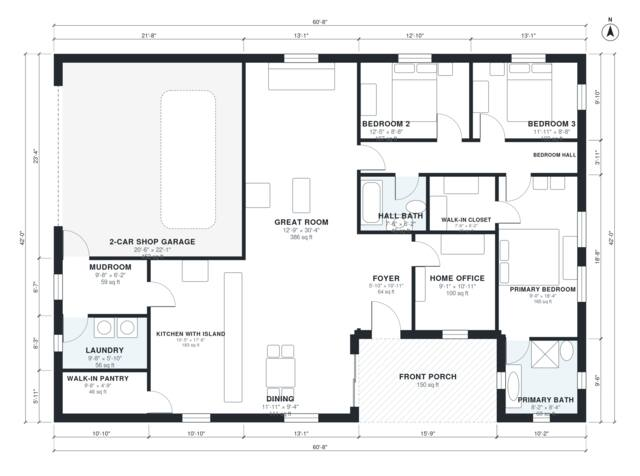

# Barndominium With Office Floor Plans: 3 Bed, 1,890 Sq Ft

This single-level barndominium has about 186 m² (2,000 sq ft) of living space plus a 48 m² shop garage and a covered front porch. A home office sits beside the entry foyer, and the open great room, dining and island kitchen with walk-in pantry share one sweep of space. The three bedrooms are grouped off a private hall, the primary suite has its own bath and walk-in closet, and the garage enters through a mudroom with the laundry beside it.

| | |
|---|---|
| Levels | 1 |
| Footprint | 18.5 m × 12.8 m (61 ft × 42 ft) |
| Rooms | 16 indoor, 1 outdoor |
| Indoor area including garage, from the room grid | about 223 m² (2,399 sq ft) |

## Files here

- `area-schedule.csv` (room schedule)
- `building.json` (rooms, walls, openings as data)
- `plan-level1.dxf` (floor plan, DXF, drawing units: inches)

## More for this plan

- Plan page with the PDF plan set, IFC and 3D model, and a tool to change the plan: https://floorplan.ai-architectures.com/house-plans/barndominium-with-office-floor-plans?utm_source=github-plans&utm_medium=probe&utm_campaign=github
- PDF plan set: https://storage.googleapis.com/20img/house-plans/barndominium-with-office-floor-plans/plan-set.pdf
- IFC model: https://storage.googleapis.com/20img/house-plans/barndominium-with-office-floor-plans/model.ifc

## Known issues in this drawing

- Primary Bath is 6.4 m² (asked for about 9.0 m²).
- Primary Bedroom is only 2.74 m wide.

Concept design generated with AI. Not for construction or permit; verify with a licensed professional.
