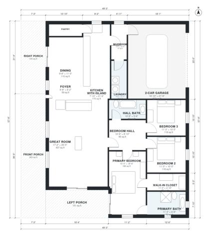

# Barndominium With Wrap Around Porch: 3 Bed, 1,860 Sq Ft

This single-story barndominium has about 172 m² (roughly 1,850–1,900 sq ft) of living space, plus a 2-car garage and a covered porch on the front and both sides. The open great room, kitchen with island and dining area are the centre of the home. A bedroom wing off a hall holds three bedrooms and two baths, with the primary suite at the far end. The pantry and laundry are included, and the mudroom links the garage to the kitchen and laundry.

| | |
|---|---|
| Levels | 1 |
| Footprint | 15.0 m × 17.6 m (49 ft × 58 ft) |
| Rooms | 15 indoor, 3 outdoor |
| Indoor area including garage, from the room grid | about 211 m² (2,274 sq ft) |

## Files here

- `area-schedule.csv` (room schedule)
- `building.json` (rooms, walls, openings as data)
- `plan-level1.dxf` (floor plan, DXF, drawing units: inches)

## More for this plan

- Plan page with the PDF plan set, IFC and 3D model, and a tool to change the plan: https://floorplan.ai-architectures.com/house-plans/barndominium-with-wrap-around-porch?utm_source=github-plans&utm_medium=probe&utm_campaign=github
- PDF plan set: https://storage.googleapis.com/20img/house-plans/barndominium-with-wrap-around-porch/plan-set.pdf
- IFC model: https://storage.googleapis.com/20img/house-plans/barndominium-with-wrap-around-porch/model.ifc

## Known issues in this drawing

- Right Porch is not on the street side.

Concept design generated with AI. Not for construction or permit; verify with a licensed professional.
