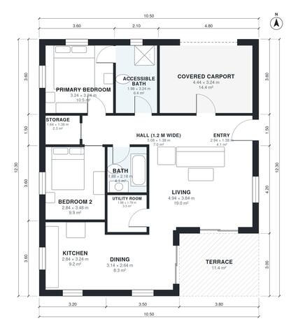

# Barrier Free Bungalow Plans: 2 Bed, 2 Bath, 1,080 Sq Ft

A compact, step-free single-storey home of roughly 99 m² of living space. The carport at the front opens to the entry. A 1.2 m hall serves two bedrooms, an accessible bath with a walk-in shower, a second bath and storage. The open kitchen, dining and living area opens to a south-facing terrace.

| | |
|---|---|
| Levels | 1 |
| Footprint | 10.5 m × 12.3 m (34 ft × 40 ft) |
| Rooms | 12 indoor, 1 outdoor |
| Indoor area including garage, from the room grid | about 118 m² (1,267 sq ft) |

## Files here

- `area-schedule.csv` (room schedule)
- `building.json` (rooms, walls, openings as data)
- `plan-level1.dxf` (floor plan, DXF, drawing units: millimetres)

## More for this plan

- Plan page with the PDF plan set, IFC and 3D model, and a tool to change the plan: https://floorplan.ai-architectures.com/house-plans/barrier-free-bungalow-plans?utm_source=github-plans&utm_medium=probe&utm_campaign=github
- PDF plan set: https://storage.googleapis.com/20img/house-plans/barrier-free-bungalow-plans/plan-set.pdf
- IFC model: https://storage.googleapis.com/20img/house-plans/barrier-free-bungalow-plans/model.ifc

## Known issues in this drawing

- Kitchen and Utility Room are not directly connected.

Concept design generated with AI. Not for construction or permit; verify with a licensed professional.
