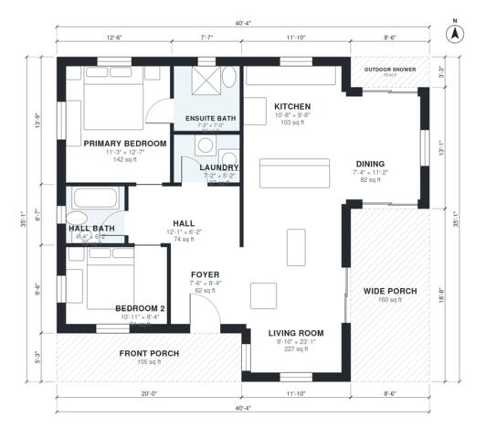

# Beach Cottage Plans: 2-Bed, 2-Bath, 1,120 Sq Ft Single Story

A single-story beach cottage with about 100 m² (about 1,080 sq ft) of indoor living space, plus a front porch, a wide rear porch and an outdoor shower. The kitchen, dining and living area is open and runs out to the wide porch. The primary suite and the second bedroom sit on the other side of the plan, near the hall bath and laundry.

| | |
|---|---|
| Levels | 1 |
| Footprint | 12.3 m × 10.7 m (40 ft × 35 ft) |
| Rooms | 10 indoor, 3 outdoor |
| Indoor area including garage, from the room grid | about 104 m² (1,124 sq ft) |

## Files here

- `area-schedule.csv` (room schedule)
- `building.json` (rooms, walls, openings as data)
- `plan-level1.dxf` (floor plan, DXF, drawing units: inches)

## More for this plan

- Plan page with the PDF plan set, IFC and 3D model, and a tool to change the plan: https://floorplan.ai-architectures.com/house-plans/beach-cottage-plans?utm_source=github-plans&utm_medium=probe&utm_campaign=github
- PDF plan set: https://storage.googleapis.com/20img/house-plans/beach-cottage-plans/plan-set.pdf
- IFC model: https://storage.googleapis.com/20img/house-plans/beach-cottage-plans/model.ifc

## Known issues in this drawing

- Living Room is only 3.00 m wide.
- Kitchen is 9.5 m² (asked for about 13.0 m²).
- Dining is only 2.24 m wide.

Concept design generated with AI. Not for construction or permit; verify with a licensed professional.
