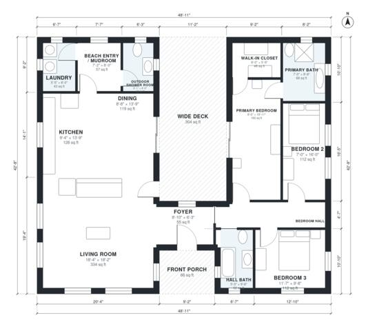

# Beach House Plans: 3-Bedroom One-Story with Wide Deck

This is a single-story coastal home of about 1,700 sq ft indoors, plus a 304 sq ft wide deck and a front porch. The kitchen, dining and living area is one open space that opens onto the deck. The primary suite with bath and walk-in closet is on the east side. Two more bedrooms and a hall bath are off a bedroom hall. A beach-entry mudroom connects the laundry and the outdoor shower room.

| | |
|---|---|
| Levels | 1 |
| Footprint | 14.9 m × 13.0 m (49 ft × 43 ft) |
| Rooms | 14 indoor, 2 outdoor |
| Indoor area including garage, from the room grid | about 159 m² (1,715 sq ft) |

## Files here

- `area-schedule.csv` (room schedule)
- `building.json` (rooms, walls, openings as data)
- `plan-level1.dxf` (floor plan, DXF, drawing units: inches)

## More for this plan

- Plan page with the PDF plan set, IFC and 3D model, and a tool to change the plan: https://floorplan.ai-architectures.com/house-plans/beach-house-plans?utm_source=github-plans&utm_medium=probe&utm_campaign=github
- PDF plan set: https://storage.googleapis.com/20img/house-plans/beach-house-plans/plan-set.pdf
- IFC model: https://storage.googleapis.com/20img/house-plans/beach-house-plans/model.ifc

## Known issues in this drawing

- Kitchen is 11.9 m² (asked for about 17.0 m²).
- Foyer is 5.1 m² (asked for about 7.0 m²).
- Primary Bedroom is only 2.44 m wide.
- Bedroom 2 is only 2.14 m wide.

Concept design generated with AI. Not for construction or permit; verify with a licensed professional.
