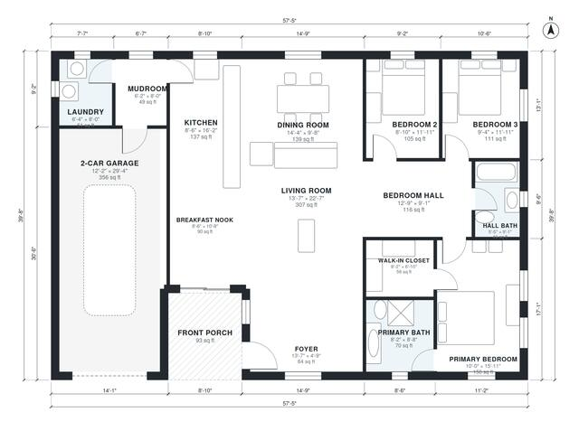

# Brick Ranch House Plans: 3 Bed, 2 Bath, 1,760 Sq Ft Home

This is a single-story brick ranch of about 172 m² (1,850 sq ft) of living space, plus a 2-car garage and a front porch. The open kitchen, dining and living area sits along the south side. The primary suite and two bedrooms are grouped in a separate wing off a hall, and the garage entry runs through a mudroom beside the laundry. The foyer and breakfast nook are a little tight, and we can adjust them if you'd like.

| | |
|---|---|
| Levels | 1 |
| Footprint | 17.5 m × 12.1 m (57 ft × 40 ft) |
| Rooms | 15 indoor, 1 outdoor |
| Indoor area including garage, from the room grid | about 203 m² (2,186 sq ft) |

## Files here

- `area-schedule.csv` (room schedule)
- `building.json` (rooms, walls, openings as data)
- `plan-level1.dxf` (floor plan, DXF, drawing units: inches)

## More for this plan

- Plan page with the PDF plan set, IFC and 3D model, and a tool to change the plan: https://floorplan.ai-architectures.com/house-plans/brick-ranch-house-plans?utm_source=github-plans&utm_medium=probe&utm_campaign=github
- PDF plan set: https://storage.googleapis.com/20img/house-plans/brick-ranch-house-plans/plan-set.pdf
- IFC model: https://storage.googleapis.com/20img/house-plans/brick-ranch-house-plans/model.ifc

## Known issues in this drawing

- Living Room is only 4.14 m wide.

Concept design generated with AI. Not for construction or permit; verify with a licensed professional.
