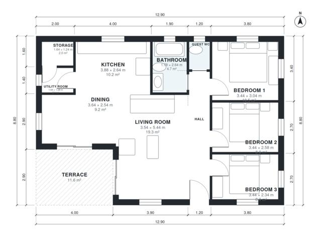

# 100 M2 Bungalow House Plans: 3-Bed, 1,100 Sq Ft Layout

This is a compact single-storey house of about 100 m² (excluding the 11.6 m² terrace), with three bedrooms, one bathroom and a guest WC grouped along the east side off a central hall. The kitchen, dining and living area is open and flows out to a south-west terrace, with the utility room and storage tucked behind the kitchen. Bedroom 3 and the dining area are on the tight side, but the layout is efficient and works well for a family.

| | |
|---|---|
| Levels | 1 |
| Footprint | 12.9 m × 8.8 m (42 ft × 29 ft) |
| Rooms | 11 indoor, 1 outdoor |
| Indoor area including garage, from the room grid | about 102 m² (1,097 sq ft) |

## Files here

- `area-schedule.csv` (room schedule)
- `building.json` (rooms, walls, openings as data)
- `plan-level1.dxf` (floor plan, DXF, drawing units: millimetres)

## More for this plan

- Plan page with the PDF plan set, IFC and 3D model, and a tool to change the plan: https://floorplan.ai-architectures.com/house-plans/bungalow-house-plans-100-m2?utm_source=github-plans&utm_medium=probe&utm_campaign=github
- PDF plan set: https://storage.googleapis.com/20img/house-plans/bungalow-house-plans-100-m2/plan-set.pdf
- IFC model: https://storage.googleapis.com/20img/house-plans/bungalow-house-plans-100-m2/model.ifc

## Known issues in this drawing

- Dining is only 2.54 m wide.
- Utility Room is 2.1 m² (asked for about 4.0 m²).
- Storage is 2.0 m² (asked for about 3.0 m²).
- Bedroom 3 is only 2.34 m wide.

Concept design generated with AI. Not for construction or permit; verify with a licensed professional.
