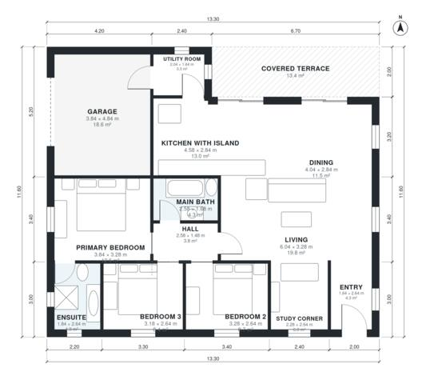

# 120 M2 Bungalow House Plans: 3 Bed, 2 Bath, 1,280 Sq Ft

This is a compact single-story home of about 119 m² of living space on a 13.3 x 11.6 m footprint. A 1-car garage and a 13 m² covered terrace are on top of that. The entry leads into an open living, kitchen-with-island and dining area that opens onto the terrace. A central hall serves the three bedrooms, with an ensuite off the primary bedroom, plus the main bath. A utility room links the kitchen to the garage.

| | |
|---|---|
| Levels | 1 |
| Footprint | 13.3 m × 11.6 m (44 ft × 38 ft) |
| Rooms | 13 indoor, 1 outdoor |
| Indoor area including garage, from the room grid | about 141 m² (1,516 sq ft) |

## Files here

- `area-schedule.csv` (room schedule)
- `building.json` (rooms, walls, openings as data)
- `plan-level1.dxf` (floor plan, DXF, drawing units: millimetres)

## More for this plan

- Plan page with the PDF plan set, IFC and 3D model, and a tool to change the plan: https://floorplan.ai-architectures.com/house-plans/bungalow-house-plans-120-m2?utm_source=github-plans&utm_medium=probe&utm_campaign=github
- PDF plan set: https://storage.googleapis.com/20img/house-plans/bungalow-house-plans-120-m2/plan-set.pdf
- IFC model: https://storage.googleapis.com/20img/house-plans/bungalow-house-plans-120-m2/model.ifc

## Known issues in this drawing

- Utility Room is 3.3 m² (asked for about 5.0 m²).

Concept design generated with AI. Not for construction or permit; verify with a licensed professional.
