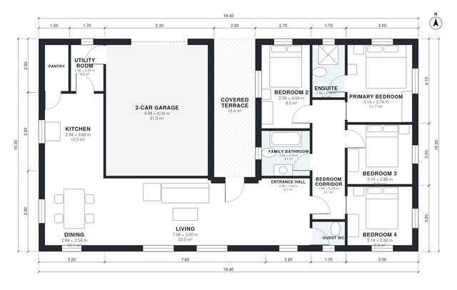

# 140 M2 Bungalow House Plans: 4-Bed L-Shaped, 1,510 Sq Ft

A single-storey 4-bedroom bungalow of about 140 m² of living space, plus a 36 m² two-car garage and a covered terrace. The open living, dining and kitchen area faces the terrace. The garage connects through the utility room, and the primary suite, family bath and three bedrooms sit on a corridor. The revision adds a small second hall so the fourth bedroom has a proper, private entrance.

| | |
|---|---|
| Levels | 1 |
| Footprint | 18.4 m × 10.3 m (60 ft × 34 ft) |
| Rooms | 15 indoor, 1 outdoor |
| Indoor area including garage, from the room grid | about 176 m² (1,896 sq ft) |

## Files here

- `area-schedule.csv` (room schedule)
- `building.json` (rooms, walls, openings as data)
- `plan-level1.dxf` (floor plan, DXF, drawing units: millimetres)

## More for this plan

- Plan page with the PDF plan set, IFC and 3D model, and a tool to change the plan: https://floorplan.ai-architectures.com/house-plans/bungalow-house-plans-140-m2?utm_source=github-plans&utm_medium=probe&utm_campaign=github
- PDF plan set: https://storage.googleapis.com/20img/house-plans/bungalow-house-plans-140-m2/plan-set.pdf
- IFC model: https://storage.googleapis.com/20img/house-plans/bungalow-house-plans-140-m2/model.ifc

## Known issues in this drawing

- Living is only 3.00 m wide.
- Bedroom 2 is only 2.34 m wide.

Concept design generated with AI. Not for construction or permit; verify with a licensed professional.
