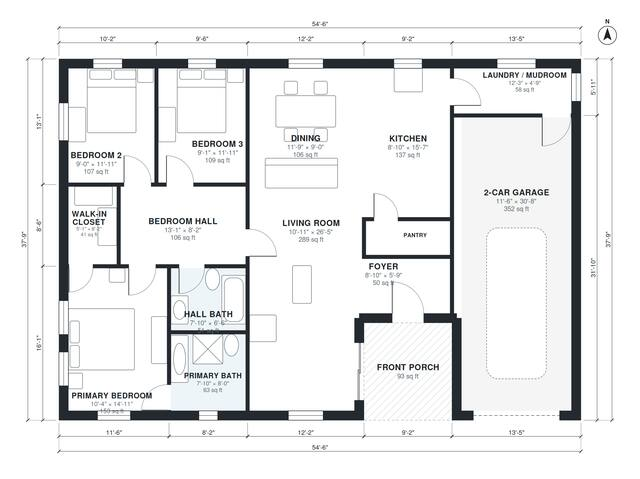

# Bungalow House Plans With Garage: 1,530 Sq Ft, 3 Bed, 2 Bath

A single-story craftsman bungalow with about 144 m² (1,550 sq ft) of living space, plus a 2-car garage and front porch. It has an open kitchen, living and dining area, and a laundry/mudroom between the garage and kitchen. The three bedrooms are in a wing off a hall, with a primary suite (ensuite and walk-in closet) and a shared hall bath.

| | |
|---|---|
| Levels | 1 |
| Footprint | 16.6 m × 11.5 m (54 ft × 38 ft) |
| Rooms | 14 indoor, 1 outdoor |
| Indoor area including garage, from the room grid | about 182 m² (1,961 sq ft) |

## Files here

- `area-schedule.csv` (room schedule)
- `building.json` (rooms, walls, openings as data)
- `plan-level1.dxf` (floor plan, DXF, drawing units: inches)

## More for this plan

- Plan page with the PDF plan set, IFC and 3D model, and a tool to change the plan: https://floorplan.ai-architectures.com/house-plans/bungalow-house-plans-with-garage?utm_source=github-plans&utm_medium=probe&utm_campaign=github
- PDF plan set: https://storage.googleapis.com/20img/house-plans/bungalow-house-plans-with-garage/plan-set.pdf
- IFC model: https://storage.googleapis.com/20img/house-plans/bungalow-house-plans-with-garage/model.ifc

## Known issues in this drawing

- None found by the automatic checks.

Concept design generated with AI. Not for construction or permit; verify with a licensed professional.
