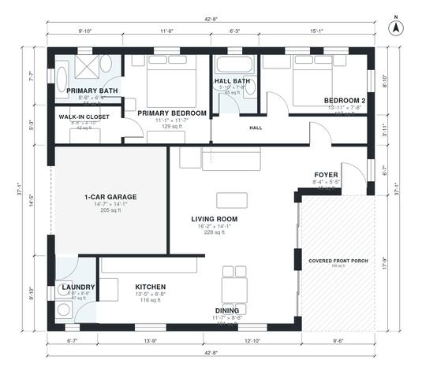

# Bungalow House Plans: 2 Bed, 2 Bath, 1,190 Sq Ft Design

This is a one-story craftsman bungalow with about 1,200 sq ft of living space, two bedrooms and two baths. A deep covered porch leads into a foyer, then to a large living room that is open to the kitchen and dining area. The private bedroom wing has a primary suite with a walk-in closet and a second bedroom next to the hall bath. A 1-car garage connects through the laundry.

| | |
|---|---|
| Levels | 1 |
| Footprint | 13.0 m × 11.3 m (43 ft × 37 ft) |
| Rooms | 12 indoor, 1 outdoor |
| Indoor area including garage, from the room grid | about 131 m² (1,413 sq ft) |

## Files here

- `area-schedule.csv` (room schedule)
- `building.json` (rooms, walls, openings as data)
- `plan-level1.dxf` (floor plan, DXF, drawing units: inches)

## More for this plan

- Plan page with the PDF plan set, IFC and 3D model, and a tool to change the plan: https://floorplan.ai-architectures.com/house-plans/bungalow-house-plans?utm_source=github-plans&utm_medium=probe&utm_campaign=github
- PDF plan set: https://storage.googleapis.com/20img/house-plans/bungalow-house-plans/plan-set.pdf
- IFC model: https://storage.googleapis.com/20img/house-plans/bungalow-house-plans/model.ifc

## Known issues in this drawing

- Bedroom 2 is only 2.34 m wide.

Concept design generated with AI. Not for construction or permit; verify with a licensed professional.
