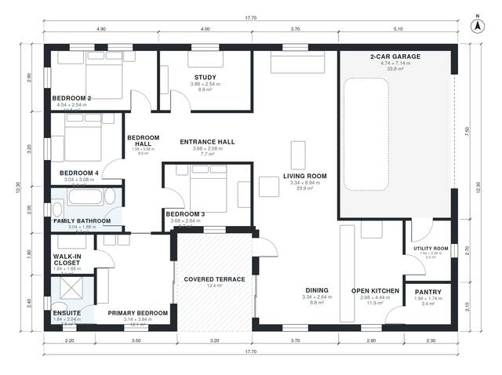

# Bungalow With Double Garage Plans: 4 Bed, 1,790 Sq Ft

This is a single-storey, 4-bedroom bungalow with about 165 m² of living space on a compact 15.8 x 13.7 m footprint, plus a 2-car garage and a covered terrace. An entrance hall leads to a long open living, dining and kitchen area with a pantry and a utility room that links to the garage. A separate bedroom hall serves the four bedrooms, the family bath and the primary suite with its ensuite and walk-in closet. A study is off the entrance hall.

| | |
|---|---|
| Levels | 1 |
| Footprint | 17.7 m × 12.3 m (58 ft × 40 ft) |
| Rooms | 16 indoor, 1 outdoor |
| Indoor area including garage, from the room grid | about 204 m² (2,199 sq ft) |

## Files here

- `area-schedule.csv` (room schedule)
- `building.json` (rooms, walls, openings as data)
- `plan-level1.dxf` (floor plan, DXF, drawing units: millimetres)

## More for this plan

- Plan page with the PDF plan set, IFC and 3D model, and a tool to change the plan: https://floorplan.ai-architectures.com/house-plans/bungalow-with-double-garage-plans?utm_source=github-plans&utm_medium=probe&utm_campaign=github
- PDF plan set: https://storage.googleapis.com/20img/house-plans/bungalow-with-double-garage-plans/plan-set.pdf
- IFC model: https://storage.googleapis.com/20img/house-plans/bungalow-with-double-garage-plans/model.ifc

## Known issues in this drawing

- Dining is 8.8 m² (asked for about 12.0 m²).

Concept design generated with AI. Not for construction or permit; verify with a licensed professional.
