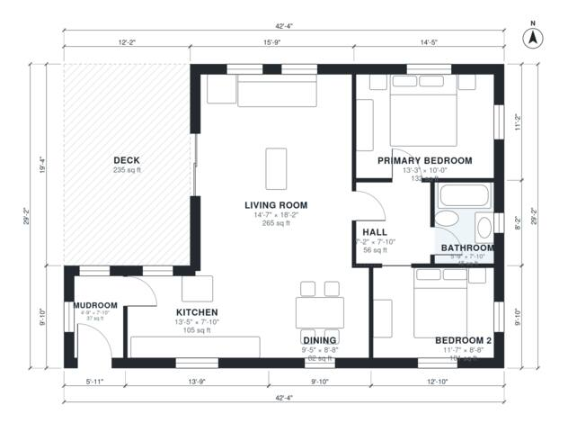

# Cabin Floor Plans: 2-Bed, 1-Bath Mountain Cabin Plan

This is a compact single-level mountain cabin of about 1,000 sq ft of heated space, plus a 235 sq ft deck. You enter through a mudroom into an open kitchen, dining and living area that opens onto the big deck. A short hall leads to the primary bedroom, a second bedroom and a shared full bath.

| | |
|---|---|
| Levels | 1 |
| Footprint | 12.9 m × 8.9 m (42 ft × 29 ft) |
| Rooms | 8 indoor, 1 outdoor |
| Indoor area including garage, from the room grid | about 93 m² (1,001 sq ft) |

## Files here

- `building.json` (rooms, walls, openings as data)
- `plan-level1.dxf` (floor plan, DXF, drawing units: inches)

## More for this plan

- Plan page with the PDF plan set, IFC and 3D model, and a tool to change the plan: https://floorplan.ai-architectures.com/house-plans/cabin-floor-plans?utm_source=github-plans&utm_medium=probe&utm_campaign=github
- PDF plan set: https://storage.googleapis.com/20img/house-plans/cabin-floor-plans/plan-set.pdf
- IFC model: https://storage.googleapis.com/20img/house-plans/cabin-floor-plans/model.ifc

## Known issues in this drawing

- Mudroom is 3.5 m² (asked for about 5.5 m²).

Concept design generated with AI. Not for construction or permit; verify with a licensed professional.
