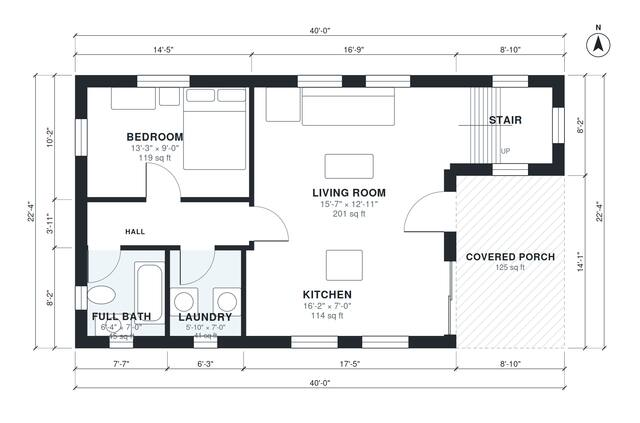

# Cabin Plans With Loft: 2-Bed, 1.5-Bath, 1,190 Sq Ft Design

This is a compact two-level loft cabin of about 107 m² (roughly 1,150 sq ft). The open living room and kitchen sit beside a covered front porch. A short hall leads to the ground-floor bedroom, full bath and laundry. A stair leads up to a sleeping loft with its own half bath, which works as a second bedroom. The ground-floor bedroom is a little smaller than requested, and the kitchen is a galley run along one wall.

| | |
|---|---|
| Levels | 2 |
| Footprint | 12.2 m × 6.8 m (40 ft × 22 ft) |
| Rooms | 11 indoor, 2 outdoor |
| Indoor area including garage, from the room grid | about 110 m² (1,185 sq ft) |

## Files here

- `area-schedule.csv` (room schedule)
- `building.json` (rooms, walls, openings as data)
- `plan-level1.dxf` (floor plan, DXF, drawing units: inches)
- `plan-level2.dxf` (floor plan, DXF, drawing units: inches)

## More for this plan

- Plan page with the PDF plan set, IFC and 3D model, and a tool to change the plan: https://floorplan.ai-architectures.com/house-plans/cabin-plans-with-loft?utm_source=github-plans&utm_medium=probe&utm_campaign=github
- PDF plan set: https://storage.googleapis.com/20img/house-plans/cabin-plans-with-loft/plan-set.pdf
- IFC model: https://storage.googleapis.com/20img/house-plans/cabin-plans-with-loft/model.ifc

## Known issues in this drawing

- Kitchen is only 2.14 m wide.

Concept design generated with AI. Not for construction or permit; verify with a licensed professional.
