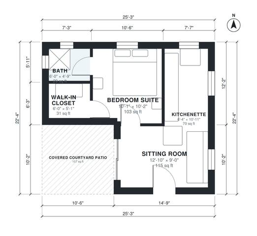

# Casita Floor Plans: 460 Sq Ft 1-Bed Courtyard Casita Plan

This is a compact Pueblo Revival casita of about 42 m² (450 sq ft) indoors, plus a covered courtyard patio of about 9 m². The front door opens into an open sitting room and kitchenette. A private bedroom suite with a bath and walk-in closet sits beside it, and the patio is reachable from both the sitting room and the bedroom. I changed the footprint to a squarer shape so the sitting room and bedroom are wider and the bath is larger.

| | |
|---|---|
| Levels | 1 |
| Footprint | 7.7 m × 6.8 m (25 ft × 22 ft) |
| Rooms | 5 indoor, 1 outdoor |
| Indoor area including garage, from the room grid | about 42 m² (457 sq ft) |

## Files here

- `area-schedule.csv` (room schedule)
- `building.json` (rooms, walls, openings as data)
- `plan-level1.dxf` (floor plan, DXF, drawing units: inches)

## More for this plan

- Plan page with the PDF plan set, IFC and 3D model, and a tool to change the plan: https://floorplan.ai-architectures.com/house-plans/casita-floor-plans?utm_source=github-plans&utm_medium=probe&utm_campaign=github
- PDF plan set: https://storage.googleapis.com/20img/house-plans/casita-floor-plans/plan-set.pdf
- IFC model: https://storage.googleapis.com/20img/house-plans/casita-floor-plans/model.ifc

## Known issues in this drawing

- Sitting Room is only 2.74 m wide.
- Walk-in Closet is 2.8 m² (asked for about 4.0 m²).
- Bath is 2.6 m² (asked for about 4.5 m²).

Concept design generated with AI. Not for construction or permit; verify with a licensed professional.
