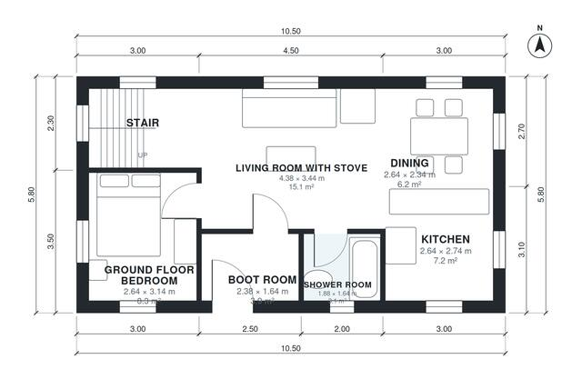

# Chalet House Plans: 3 Bed, 2 Bath, 1,310 Sq Ft Two-Story

This is a compact two-storey alpine chalet of about 120 m² (excluding the garage), on a 10.5 x 5.8 m footprint under a steep gable roof. Downstairs, a boot room opens into an open kitchen, dining and living area with a stove and large gable windows. The ground floor also has a bedroom and a shower room. Upstairs, a gallery above the living space leads to two bedrooms and a bath.

| | |
|---|---|
| Levels | 2 |
| Footprint | 10.5 m × 5.8 m (34 ft × 19 ft) |
| Rooms | 12 indoor, 0 outdoor |
| Indoor area including garage, from the room grid | about 122 m² (1,311 sq ft) |

## Files here

- `area-schedule.csv` (room schedule)
- `building.json` (rooms, walls, openings as data)
- `plan-level1.dxf` (floor plan, DXF, drawing units: millimetres)
- `plan-level2.dxf` (floor plan, DXF, drawing units: millimetres)

## More for this plan

- Plan page with the PDF plan set, IFC and 3D model, and a tool to change the plan: https://floorplan.ai-architectures.com/house-plans/chalet-house-plans?utm_source=github-plans&utm_medium=probe&utm_campaign=github
- PDF plan set: https://storage.googleapis.com/20img/house-plans/chalet-house-plans/plan-set.pdf
- IFC model: https://storage.googleapis.com/20img/house-plans/chalet-house-plans/model.ifc

## Known issues in this drawing

- Dining is only 2.34 m wide.

Concept design generated with AI. Not for construction or permit; verify with a licensed professional.
