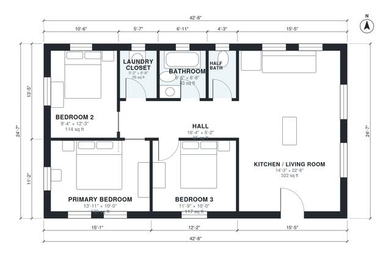

# Cheap House Plans to Build: 3 Bed, 1,050 Sq Ft One-Story

A plain rectangular single-story ranch of about 97 m² (1,050 sq ft) under one gable roof. An open kitchen and living room sits at the front, and a short hall serves three bedrooms, a full bath, a half bath and a laundry closet. The wet rooms share one plumbing wall to keep costs low, and there is no garage.

| | |
|---|---|
| Levels | 1 |
| Footprint | 13.0 m × 7.5 m (43 ft × 25 ft) |
| Rooms | 8 indoor, 0 outdoor |
| Indoor area including garage, from the room grid | about 98 m² (1,049 sq ft) |

## Files here

- `area-schedule.csv` (room schedule)
- `building.json` (rooms, walls, openings as data)
- `plan-level1.dxf` (floor plan, DXF, drawing units: inches)

## More for this plan

- Plan page with the PDF plan set, IFC and 3D model, and a tool to change the plan: https://floorplan.ai-architectures.com/house-plans/cheap-house-plans-to-build?utm_source=github-plans&utm_medium=probe&utm_campaign=github
- PDF plan set: https://storage.googleapis.com/20img/house-plans/cheap-house-plans-to-build/plan-set.pdf
- IFC model: https://storage.googleapis.com/20img/house-plans/cheap-house-plans-to-build/model.ifc

## Known issues in this drawing

- None found by the automatic checks.

Concept design generated with AI. Not for construction or permit; verify with a licensed professional.
