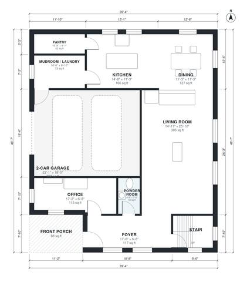

# Contemporary House Plans: 4-Bed, 2-Story, 2,560 Sq Ft

This is a two-story contemporary home with about 237 m² (roughly 2,550 sq ft) of living space, plus a 2-car garage and a covered front porch. The ground floor has an open kitchen, dining and living area, an office by the entry, a powder room and a mudroom/laundry that links the garage to the kitchen. Upstairs, a primary suite with a bath and walk-in closet sits at the end of the hall, with three more bedrooms and a shared hall bath.

| | |
|---|---|
| Levels | 2 |
| Footprint | 12.0 m × 14.2 m (39 ft × 47 ft) |
| Rooms | 19 indoor, 2 outdoor |
| Indoor area including garage, from the room grid | about 277 m² (2,984 sq ft) |

## Files here

- `area-schedule.csv` (room schedule)
- `building.json` (rooms, walls, openings as data)
- `plan-level1.dxf` (floor plan, DXF, drawing units: inches)
- `plan-level2.dxf` (floor plan, DXF, drawing units: inches)

## More for this plan

- Plan page with the PDF plan set, IFC and 3D model, and a tool to change the plan: https://floorplan.ai-architectures.com/house-plans/contemporary-house-plans?utm_source=github-plans&utm_medium=probe&utm_campaign=github
- PDF plan set: https://storage.googleapis.com/20img/house-plans/contemporary-house-plans/plan-set.pdf
- IFC model: https://storage.googleapis.com/20img/house-plans/contemporary-house-plans/model.ifc

## Known issues in this drawing

- None found by the automatic checks.

Concept design generated with AI. Not for construction or permit; verify with a licensed professional.
