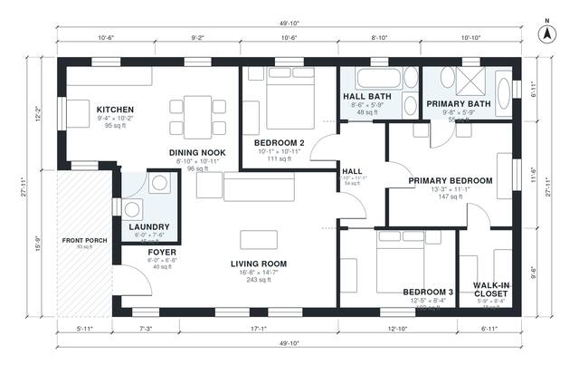

# Cottage House Plans: 3-Bed, 2-Bath One-Story, 1,300 Sq Ft

This is a compact one-story cottage of about 1,290 sq ft indoors, plus a covered front porch of about 93 sq ft. The foyer opens into a bright, open living, dining and kitchen area. A private hall serves the primary suite (bath and walk-in closet), two more bedrooms and a shared bath. The rectangular footprint suits the steep gable roof.

| | |
|---|---|
| Levels | 1 |
| Footprint | 15.2 m × 8.5 m (50 ft × 28 ft) |
| Rooms | 12 indoor, 1 outdoor |
| Indoor area including garage, from the room grid | about 121 m² (1,298 sq ft) |

## Files here

- `area-schedule.csv` (room schedule)
- `building.json` (rooms, walls, openings as data)
- `plan-level1.dxf` (floor plan, DXF, drawing units: inches)

## More for this plan

- Plan page with the PDF plan set, IFC and 3D model, and a tool to change the plan: https://floorplan.ai-architectures.com/house-plans/cottage-house-plans?utm_source=github-plans&utm_medium=probe&utm_campaign=github
- PDF plan set: https://storage.googleapis.com/20img/house-plans/cottage-house-plans/plan-set.pdf
- IFC model: https://storage.googleapis.com/20img/house-plans/cottage-house-plans/model.ifc

## Known issues in this drawing

- Kitchen is 8.8 m² (asked for about 14.0 m²).

Concept design generated with AI. Not for construction or permit; verify with a licensed professional.
