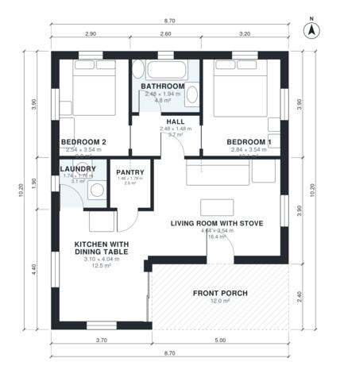

# Country House Plans 2 Bedroom: 830 Sq Ft with Front Porch

This is a compact single-storey country house of about 77 m² indoors, plus a 12 m² deep front porch. You enter through the porch into a living room with a stove, which opens to a kitchen with a dining table. The kitchen has a pantry and a laundry with its own garden door. Two bedrooms and the bathroom sit together off a short hall at the back, away from the living area.

| | |
|---|---|
| Levels | 1 |
| Footprint | 8.7 m × 10.2 m (29 ft × 33 ft) |
| Rooms | 8 indoor, 1 outdoor |
| Indoor area including garage, from the room grid | about 77 m² (826 sq ft) |

## Files here

- `area-schedule.csv` (room schedule)
- `building.json` (rooms, walls, openings as data)
- `plan-level1.dxf` (floor plan, DXF, drawing units: millimetres)

## More for this plan

- Plan page with the PDF plan set, IFC and 3D model, and a tool to change the plan: https://floorplan.ai-architectures.com/house-plans/country-house-plans-2-bedroom?utm_source=github-plans&utm_medium=probe&utm_campaign=github
- PDF plan set: https://storage.googleapis.com/20img/house-plans/country-house-plans-2-bedroom/plan-set.pdf
- IFC model: https://storage.googleapis.com/20img/house-plans/country-house-plans-2-bedroom/model.ifc

## Known issues in this drawing

- None found by the automatic checks.

Concept design generated with AI. Not for construction or permit; verify with a licensed professional.
