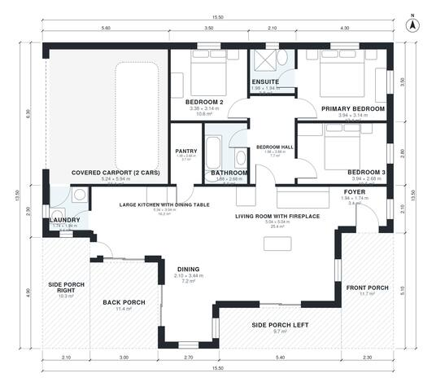

# Country House Plans with Porch: 3-Bed, 1,410 Sq Ft Plan

A single-storey country house of about 130 m² of living space with three bedrooms and two baths. The bedrooms are grouped on a private hall, and there is a large kitchen with a dining table that opens to a living room with a fireplace. A pantry and laundry sit beside the 2-car covered carport, and a deep porch wraps three sides. The revision removes the narrow dining sliver and gives the foyer and laundry more room.

| | |
|---|---|
| Levels | 1 |
| Footprint | 15.5 m × 13.5 m (51 ft × 44 ft) |
| Rooms | 13 indoor, 4 outdoor |
| Indoor area including garage, from the room grid | about 166 m² (1,788 sq ft) |

## Files here

- `area-schedule.csv` (room schedule)
- `building.json` (rooms, walls, openings as data)
- `plan-level1.dxf` (floor plan, DXF, drawing units: millimetres)

## More for this plan

- Plan page with the PDF plan set, IFC and 3D model, and a tool to change the plan: https://floorplan.ai-architectures.com/house-plans/country-house-plans-with-porch?utm_source=github-plans&utm_medium=probe&utm_campaign=github
- PDF plan set: https://storage.googleapis.com/20img/house-plans/country-house-plans-with-porch/plan-set.pdf
- IFC model: https://storage.googleapis.com/20img/house-plans/country-house-plans-with-porch/model.ifc

## Known issues in this drawing

- Laundry is 3.4 m² (asked for about 5.0 m²).
- Dining is 7.2 m² (asked for about 10.0 m²).
- Dining is only 2.10 m wide.
- Foyer is 3.4 m² (asked for about 5.0 m²).

Concept design generated with AI. Not for construction or permit; verify with a licensed professional.
