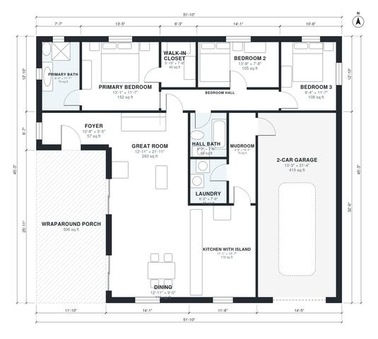

# Country House Plans: 3-Bed, 2-Bath One-Story, 1,570 Sq Ft

This is a single-story modern farmhouse with about 175 m² (roughly 1,880 sq ft) of living space. The garage and porch are on top of that. An open kitchen with island, dining area and great room face the wraparound porch. The three bedrooms are grouped on the north side, with the primary suite at one end and a shared hall bath for the other two. The mudroom and laundry connect the 2-car garage to the kitchen.

| | |
|---|---|
| Levels | 1 |
| Footprint | 15.8 m × 13.8 m (52 ft × 45 ft) |
| Rooms | 14 indoor, 1 outdoor |
| Indoor area including garage, from the room grid | about 190 m² (2,041 sq ft) |

## Files here

- `area-schedule.csv` (room schedule)
- `building.json` (rooms, walls, openings as data)
- `plan-level1.dxf` (floor plan, DXF, drawing units: inches)

## More for this plan

- Plan page with the PDF plan set, IFC and 3D model, and a tool to change the plan: https://floorplan.ai-architectures.com/house-plans/country-house-plans?utm_source=github-plans&utm_medium=probe&utm_campaign=github
- PDF plan set: https://storage.googleapis.com/20img/house-plans/country-house-plans/plan-set.pdf
- IFC model: https://storage.googleapis.com/20img/house-plans/country-house-plans/model.ifc

## Known issues in this drawing

- Bedroom 2 is only 2.34 m wide.

Concept design generated with AI. Not for construction or permit; verify with a licensed professional.
