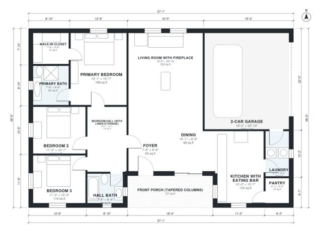

# Craftsman Bungalow House Plans: 1,660 Sq Ft, 3 Bed, 2 Bath

This is a one-story Craftsman bungalow with about 1,700 sq ft of living space (about 205 m² including the garage and porch). A front porch with tapered columns leads into a foyer and an open living, dining and kitchen area with a fireplace and an eating bar. A private wing holds the primary suite with its bath and walk-in closet, two more bedrooms and a hall bath. The 2-car garage enters through the laundry.

| | |
|---|---|
| Levels | 1 |
| Footprint | 17.4 m × 11.8 m (57 ft × 39 ft) |
| Rooms | 14 indoor, 1 outdoor |
| Indoor area including garage, from the room grid | about 194 m² (2,083 sq ft) |

## Files here

- `area-schedule.csv` (room schedule)
- `building.json` (rooms, walls, openings as data)
- `plan-level1.dxf` (floor plan, DXF, drawing units: inches)

## More for this plan

- Plan page with the PDF plan set, IFC and 3D model, and a tool to change the plan: https://floorplan.ai-architectures.com/house-plans/craftsman-bungalow-house-plans?utm_source=github-plans&utm_medium=probe&utm_campaign=github
- PDF plan set: https://storage.googleapis.com/20img/house-plans/craftsman-bungalow-house-plans/plan-set.pdf
- IFC model: https://storage.googleapis.com/20img/house-plans/craftsman-bungalow-house-plans/model.ifc

## Known issues in this drawing

- Dining is 8.1 m² (asked for about 13.0 m²).
- Kitchen with Eating Bar is only 3.04 m wide.
- 2-Car Garage is only 5.54 m wide.

Concept design generated with AI. Not for construction or permit; verify with a licensed professional.
