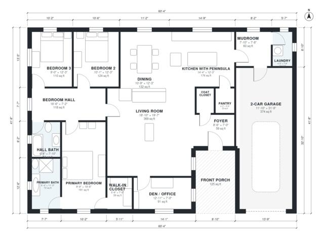

# Craftsman House Plans: 3-Bed, 1,940 Sq Ft Bungalow Design

This is a single-storey Craftsman bungalow of about 234 m² (2,520 sq ft) overall. That is roughly 2,000 sq ft heated, plus the garage and porch. It has a deep front porch, an open kitchen with a peninsula flowing into the dining and living areas, and a mudroom and laundry between the kitchen and a true 2-car garage. A separate bedroom wing holds the primary suite, two bedrooms and a hall bath, with a front den.

| | |
|---|---|
| Levels | 1 |
| Footprint | 18.4 m × 12.7 m (60 ft × 42 ft) |
| Rooms | 17 indoor, 1 outdoor |
| Indoor area including garage, from the room grid | about 222 m² (2,390 sq ft) |

## Files here

- `building.json` (rooms, walls, openings as data)
- `plan-level1.dxf` (floor plan, DXF, drawing units: inches)

## More for this plan

- Plan page with the PDF plan set, IFC and 3D model, and a tool to change the plan: https://floorplan.ai-architectures.com/house-plans/craftsman-house-plans?utm_source=github-plans&utm_medium=probe&utm_campaign=github
- PDF plan set: https://storage.googleapis.com/20img/house-plans/craftsman-house-plans/plan-set.pdf
- IFC model: https://storage.googleapis.com/20img/house-plans/craftsman-house-plans/model.ifc

## Known issues in this drawing

- Primary Bath is 6.7 m² (asked for about 9.0 m²).
- Primary Bedroom is only 2.98 m wide.
- 2-Car Garage is only 3.60 m wide.
- Laundry is 3.1 m² (asked for about 4.5 m²).

Concept design generated with AI. Not for construction or permit; verify with a licensed professional.
