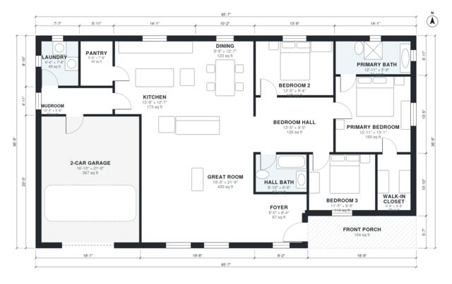

# Craftsman Ranch House Plans: 3 Bed, 2 Bath, 1,890 Sq Ft

This single-story craftsman ranch has about 175 m² (1,900 sq ft) of living space, plus a 38 m² two-car garage and a front porch. A foyer opens to a large great room that flows into the kitchen and dining area. The mudroom and laundry sit between the kitchen and the garage. The primary suite, with its bath and walk-in closet, and the two secondary bedrooms are in a separate wing off a bedroom hall.

| | |
|---|---|
| Levels | 1 |
| Footprint | 20.0 m × 11.2 m (66 ft × 37 ft) |
| Rooms | 15 indoor, 1 outdoor |
| Indoor area including garage, from the room grid | about 214 m² (2,307 sq ft) |

## Files here

- `area-schedule.csv` (room schedule)
- `building.json` (rooms, walls, openings as data)
- `plan-level1.dxf` (floor plan, DXF, drawing units: inches)

## More for this plan

- Plan page with the PDF plan set, IFC and 3D model, and a tool to change the plan: https://floorplan.ai-architectures.com/house-plans/craftsman-ranch-house-plans?utm_source=github-plans&utm_medium=probe&utm_campaign=github
- PDF plan set: https://storage.googleapis.com/20img/house-plans/craftsman-ranch-house-plans/plan-set.pdf
- IFC model: https://storage.googleapis.com/20img/house-plans/craftsman-ranch-house-plans/model.ifc

## Known issues in this drawing

- None found by the automatic checks.

Concept design generated with AI. Not for construction or permit; verify with a licensed professional.
