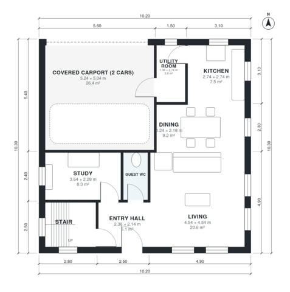

# Cube House Plans: 4-Bed Two-Story Flat Roof, 1,700 Sq Ft

This is a compact two-storey flat-roofed cube of about 10.2 x 10.3 m with roughly 150 m² of living space. The carport for two cars sits at the front and is not counted in that figure. Downstairs there is an open kitchen, dining and living area, a study, a guest WC and a utility room that links to the carport. Upstairs there are four bedrooms, a family bath, a primary ensuite and a roof terrace over the carport.

| | |
|---|---|
| Levels | 2 |
| Footprint | 10.2 m × 10.3 m (33 ft × 34 ft) |
| Rooms | 17 indoor, 1 outdoor |
| Indoor area including garage, from the room grid | about 188 m² (2,027 sq ft) |

## Files here

- `area-schedule.csv` (room schedule)
- `building.json` (rooms, walls, openings as data)
- `plan-level1.dxf` (floor plan, DXF, drawing units: millimetres)
- `plan-level2.dxf` (floor plan, DXF, drawing units: millimetres)

## More for this plan

- Plan page with the PDF plan set, IFC and 3D model, and a tool to change the plan: https://floorplan.ai-architectures.com/house-plans/cube-house-plans?utm_source=github-plans&utm_medium=probe&utm_campaign=github
- PDF plan set: https://storage.googleapis.com/20img/house-plans/cube-house-plans/plan-set.pdf
- IFC model: https://storage.googleapis.com/20img/house-plans/cube-house-plans/model.ifc

## Known issues in this drawing

- Dining is only 2.18 m wide.

Concept design generated with AI. Not for construction or permit; verify with a licensed professional.
